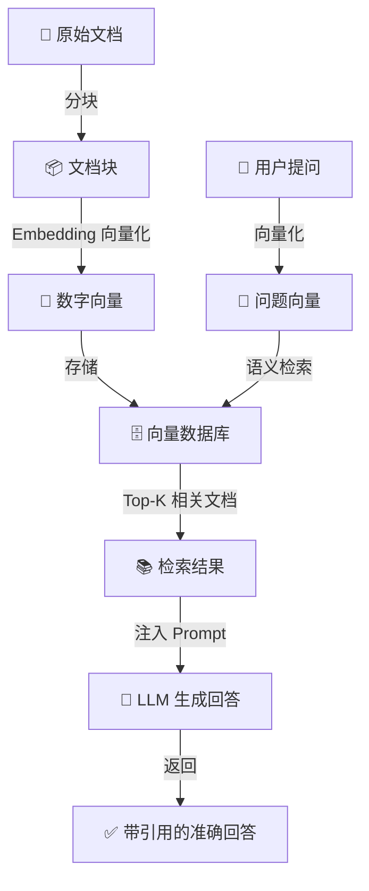

# 🤖 RAG + Agent 入门实战项目

> **面向新人的完整 RAG（检索增强生成）学习项目 —— 从零理解 Embedding、向量数据库、RAG 到构建智能 Agent。**

---

## 📖 目录

- [项目概述](#项目概述)
- [核心概念速览](#核心概念速览)
- [快速开始](#快速开始)
- [分步教程](#分步教程)
  - [第一步：理解 Embedding](#第一步理解-embedding)
  - [第二步：向量数据库实战](#第二步向量数据库实战)
  - [第三步：构建知识库](#第三步构建知识库)
  - [第四步：RAG 问答](#第四步rag-问答)
  - [第五步：Agent 智能体](#第五步agent-智能体)
- [项目架构](#项目架构)
- [进阶优化](#进阶优化)
- [常见问题](#常见问题)
- [学习路径建议](#学习路径建议)

---

## 项目概述

### 🤔 这个项目解决什么问题？

大模型（LLM）虽然强大，但存在三个致命缺陷：

| 缺陷 | 说明 | 例子 |
|------|------|------|
| **知识滞后** | 只知道训练截止日期前的信息 | 问"2024年最新政策"可能不知道 |
| **幻觉生成** | 不知道的事情会瞎编 | 约30%的回答存在事实性错误 |
| **无法访问私有数据** | 不了解企业内部文档 | 问"公司产品保修多久"回答不出 |

**RAG（Retrieval-Augmented Generation，检索增强生成）** 就是给大模型配了一个实时更新的资料库——相当于让专家"先查资料，再回答"。

> 🎯 **一句话理解：RAG = 开卷考试。大模型不再靠记忆硬答，而是先翻书（检索），再作答（生成）。**

### 🎯 你将学到什么？

通过这个项目，你将完整掌握：



---

## 核心概念速览

### 1. Embedding（向量嵌入）

**把文字/图片/音频转成数字向量的过程。语义相近的内容，向量在空间中的距离也更近。**

```
"苹果是一种很好吃的水果"  →  [0.23, -0.15, 0.78, 0.42, ...]  (512维)
"香蕉也是一种水果"        →  [0.21, -0.13, 0.75, 0.44, ...]  ← 距离很近！
"苹果公司发布了新手机"     →  [0.89, 0.62, -0.31, -0.55, ...]  ← 距离很远！
```

> 💡 **核心规律：两个向量在空间中的距离越近 = 语义越相近。** 这就是计算机"理解"语义的秘密。

### 2. 向量数据库（Vector Database）

**专门存储和检索高维向量的数据库系统。它不比较字面，而是计算"距离"来找到语义最相近的内容。**

| 对比 | 传统数据库 | 向量数据库 |
|------|-----------|-----------|
| 查询方式 | `SELECT * WHERE name LIKE '%苹果%'` | 按语义相似度排序 |
| 搜"智能手机" | 只找到含"智能手机"的文档 | 也能找到含"iPhone"、"安卓手机"的文档 |
| 搜"怎么退钱" | 找不到含"退款政策"的文档 | 精确命中含"退款政策"的文档 |

### 3. RAG（检索增强生成）

**三大步骤：**

```
📥 离线阶段（建库）
  文档 → 分块 → Embedding → 向量数据库

🔍 在线阶段（检索）  
  用户问题 → Embedding → 在向量库中搜索 Top-K → 获取相关文档

✍️ 生成阶段（增强回答）
  Prompt = 系统指令 + 检索到的文档 + 用户问题
  回答 = LLM(Prompt)
```

### 4. Agent（智能体）

**能调用工具、自主决策的 AI 系统。它不只是"回答"，更能"行动"。**

```
RAG:  问题 → 检索 → 回答（线性流程）
Agent: 问题 → 思考 → 选工具 → 执行 → 观察 → 再思考 → ... → 回答
              ↑__________________________________________↓
              这个"思考→行动→观察"循环就是 Agent 的智能所在
```

---

## 快速开始

### 环境要求

- Python 3.10+
- pip 包管理器

### 1️⃣ 克隆并进入项目

```bash
cd 1-AI/RAG-Knowledge-Base
```

### 2️⃣ 安装依赖

```bash
pip install -r requirements.txt
```

### 3️⃣ 配置 LLM API（必需）

本项目使用 OpenAI 兼容接口，支持几乎所有主流 LLM 服务商。

```bash
# 项目已自带 .env 文件（含详细注释），直接编辑即可
# 填入你自己购买/申请的 API Key
```

**.env 文件示例（三行就够了）：**
```bash
LLM_API_KEY=sk-your-real-key-here
LLM_API_BASE=https://api.deepseek.com/v1
LLM_MODEL_NAME=deepseek-chat
```

> ⚠️ **常见错误：改了 API Base 但忘了改模型名。** 不同服务商的模型名不同：DeepSeek 用 `deepseek-chat`，通义千问用 `qwen-plus`，OpenAI 用 `gpt-4o`。**Base URL、Key、Model 三者必须匹配同一服务商。**

> 💡 **验证配置是否正确：**
> ```bash
> python scripts/04_rag_qa.py --check-config   # 只打印配置，不调用 LLM
> ```

### 4️⃣ 按顺序运行演示

```bash
# 第一步：感受 Embedding 的魔力（无需 API Key）
python scripts/01_embedding_demo.py

# 第二步：玩转向量数据库 ChromaDB（无需 API Key）
python scripts/02_vector_db_demo.py

# 第三步：构建你的第一个知识库（无需 API Key，用本地 BGE 模型）
python scripts/03_build_knowledge_base.py

# 第四步：RAG 问答（需要配置 .env 中的 LLM API）
python scripts/04_rag_qa.py

# 第五步：Agent 智能体（需要配置 .env 中的 LLM API）
python scripts/05_agent_demo.py
```

---

## 分步教程

### 第一步：理解 Embedding

**运行命令：**
```bash
python scripts/01_embedding_demo.py
```

**你会看到什么：**

1. **向量的样子** —— 一句话被表示成 512 个数字
2. **语义相似度对比** —— 观察"苹果水果"和"苹果公司"的向量距离差异
3. **最简单的语义搜索** —— 用"保修多久"搜到"保修期3年"

**关键代码片段：**
```python
from sentence_transformers import SentenceTransformer

# 加载模型（首次自动下载）
model = SentenceTransformer("BAAI/bge-small-zh-v1.5")

# 文字 → 向量
vector = model.encode("苹果是一种很好吃的水果")
# 结果: [0.23, -0.15, 0.78, ...] (512个数字)

# 计算相似度
sim = cosine_similarity(
    model.encode("产品保修多久"),
    model.encode("云服务器提供 3 年标准保修服务")
)
# 结果: 0.89 (高度相似！虽然字面不同)
```

> 🎯 **核心收获：语义相近的文字 → 向量距离近。这就是 RAG 检索的基石。**

---

### 第二步：向量数据库实战

**运行命令：**
```bash
python scripts/02_vector_db_demo.py
```

**你会学到：**

| 操作 | 说明 | 类比 MySQL |
|------|------|-----------|
| 创建 Collection | 创建集合（表） | `CREATE TABLE` |
| 添加文档 | 存入文档+向量 | `INSERT INTO` |
| 语义查询 | 按相似度搜索 | 无对应！传统DB做不到 |
| 元数据过滤 | 精确+语义混合查询 | `WHERE` + 向量搜索 |
| 更新/删除 | 文档管理 | `UPDATE` / `DELETE` |

**关键代码片段：**
```python
import chromadb

# 连接数据库
client = chromadb.PersistentClient(path="./chroma_demo_db")

# 创建集合
collection = client.create_collection(name="my_knowledge_base")

# 添加文档
collection.add(
    documents=["产品保修期为 3 年", "支持 7 天无理由退款"],
    ids=["doc_1", "doc_2"],
)

# 语义搜索
results = collection.query(
    query_texts=["保修多久"],
    n_results=3,
)
# 结果精确命中"产品保修期为 3 年"！
# 虽然"保修多久"和"保修期为3年"字面不同，但语义相同
```

> 🎯 **核心收获：向量数据库不匹配字面，而是按语义相似度检索。**

---

### 第三步：构建知识库

**运行命令：**
```bash
# 使用本地免费 BGE 模型（默认，推荐）
python scripts/03_build_knowledge_base.py

# 或使用远程 Embedding API（需在 .env 中配置）
python scripts/03_build_knowledge_base.py --embedding remote
```

**这个脚本做了什么：**

```
docs/product_manual.txt（原始文档）
    │
    ▼ 加载文档
1个 Document 对象
    │
    ▼ 分块（chunk_size=500, overlap=50）
约 15-20 个文档块
    │
    ▼ 向量化（Embedding）
每个块 → 1536维向量（OpenAI）/ 512维向量（BGE）
    │
    ▼ 存入 ChromaDB
./chroma_db/ 目录（持久化存储）
```

**分块策略说明：**

| chunk_size | 效果 | 适用场景 |
|-----------|------|---------|
| 200-300 | 检索精度高，但上下文不完整 | FAQ、短问答 |
| **500-800** | **平衡精度和上下文（推荐）** | **通用文档** |
| 1000-1500 | 上下文完整，但可能引入噪声 | 技术文档、长文章 |

| chunk_overlap | 效果 |
|--------------|------|
| 0 | 无重叠，可能切断关键信息 |
| **chunk_size × 10%** | **推荐值，保持上下文连贯** |
| chunk_size × 30% | 重叠太多，检索结果冗余 |

> 🎯 **核心收获：分块策略直接影响 RAG 的检索质量。太小丢上下文，太大降精度。**

---

### 第四步：RAG 问答

**运行命令：**
```bash
# 演示模式（预设问题）
python scripts/04_rag_qa.py

# 交互模式（自己提问）
python scripts/04_rag_qa.py --interactive

# 通过命令行指定 LLM
python scripts/04_rag_qa.py --llm-api-key sk-xxx --llm-api-base https://api.deepseek.com/v1 --llm-model deepseek-chat

# 自定义检索数量
python scripts/04_rag_qa.py --k 5
```

**RAG 核心流程（完整代码）：**

```python
from app.rag_engine import RAGEngine

# 1. 创建 RAG 引擎
engine = RAGEngine(
    persist_dir="./chroma_db",
    search_k=3,  # 检索 Top-3 最相关文档
)

# 2. 提问
answer, sources = engine.query("产品保修期是多久？")

print(answer)
# 输出: "根据产品手册第2.1节，NeoCloud所有自研硬件产品
#        享有3年标准保修服务，核心部件（CPU、内存、主板）
#        享有5年有限保修..."

# 3. 查看引用的源文档
for doc in sources:
    print(doc.page_content[:100])
```

**chain_type 选择指南：**

| chain_type | 原理 | 速度 | 质量 | 适用场景 |
|-----------|------|------|------|---------|
| **stuff** | 所有文档一次性塞入 Prompt | ⚡快 | ⭐⭐⭐ | 文档块 < 5 个 |
| map_reduce | 分别提问再汇总 | 🐢慢 | ⭐⭐⭐⭐ | 文档块很多 |
| refine | 逐篇迭代优化 | 🐢最慢 | ⭐⭐⭐⭐⭐ | 对质量要求极高 |
| map_rerank | 每篇打分取最优 | ⚡快 | ⭐⭐⭐ | 只需一个最佳答案 |

> 🎯 **核心收获：RAG = 检索 + 生成。Embedding 决定了检索的上限，LLM 决定了生成的质量。**

---

### 第五步：Agent 智能体

**运行命令：**
```bash
# 基础 Agent（只有知识库工具）
python scripts/05_agent_demo.py

# 带额外工具的 Agent
python scripts/05_agent_demo.py --with-extras

# 交互式 Agent
python scripts/05_agent_demo.py --interactive
```

**Agent 与普通 RAG 的区别：**

```python
# 普通 RAG：线性流程
answer = engine.query("产品保修多久")
# 内部：问题 → 向量化 → 检索 → 生成 → 返回

# Agent：思考-行动循环
response = agent.run("查订单 ORD-001，告诉我对应的退款政策")
# 内部：
#   Thought: 需要先查订单信息，再查退款政策
#   Action: OrderQuery("ORD-001")
#   Observation: 订单产品是 NeoCompute Standard
#   Thought: 现在需要查这个产品的退款政策
#   Action: KnowledgeBase("NeoCompute Standard 退款政策")
#   Observation: 按量付费支持随时退款，包月7天内无理由退款
#   Thought: 我有足够信息了
#   Final Answer: 订单 ORD-001（NeoCompute Standard）的退款政策是...
```

**添加自定义工具：**
```python
from app.agent import RAGAgent

agent = RAGAgent()

# 添加你自己的工具
def my_custom_tool(input_text: str) -> str:
    """你的工具逻辑"""
    return f"处理结果: {input_text}"

agent.add_tool(
    name="MyTool",
    func=my_custom_tool,
    description="这个工具用于XXX。当你需要XXX时使用。输入：XXX格式。"
)
```

> 🎯 **核心收获：Agent = RAG + 工具调用 + 自主决策。它能判断该用什么工具、按什么顺序，而不仅仅是回答问题。**

---

## 项目架构

```
RAG-Knowledge-Base/
├── README.md                          # 📖 本文档
├── requirements.txt                   # 📦 Python 依赖
├── .env.example                       # 🔑 环境变量模板
│
├── docs/                              # 📂 文档目录（放你的知识库文档）
│   └── product_manual.txt             #    示例：产品手册
│
├── scripts/                           # 🔧 可执行脚本（按顺序学习）
│   ├── 01_embedding_demo.py           #    第一步：理解 Embedding
│   ├── 02_vector_db_demo.py           #    第二步：向量数据库操作
│   ├── 03_build_knowledge_base.py     #    第三步：构建知识库
│   ├── 04_rag_qa.py                   #    第四步：RAG 问答
│   └── 05_agent_demo.py              #    第五步：Agent 智能体
│
├── app/                               # 📚 核心代码模块
│   ├── __init__.py                    #    包初始化
│   ├── knowledge_base.py              #    知识库构建（文档加载、分块、向量化）
│   ├── rag_engine.py                  #    RAG 引擎（检索 + 生成）
│   └── agent.py                       #    Agent 智能体（工具调用 + 自主决策）
│
└── chroma_db/                         # 🗄️ 向量数据库存储目录（自动生成）
    └── ...                            #    ChromaDB 持久化文件
```

### 模块职责

| 模块 | 文件 | 职责 |
|------|------|------|
| **知识库** | `app/knowledge_base.py` | 文档加载、分块、向量化、存储 |
| **RAG 引擎** | `app/rag_engine.py` | 检索 + 增强生成 + 自定义 Prompt |
| **Agent** | `app/agent.py` | 工具管理、思考-行动循环、多工具协作 |

---

## 进阶优化

当你跑通基础流程后，可以通过以下方式提升效果：

### 1. 检索优化

| 优化方向 | 方法 | 效果 |
|---------|------|------|
| **混合检索** | 关键词检索(BM25) + 语义检索(Embedding) | 兼顾精确匹配和语义理解 |
| **Rerank** | 先用 Embedding 粗排，再用 Cross-Encoder 精排 | 显著提升 Top-3 准确率 |
| **多路召回** | 从不同角度检索多组结果，合并去重 | 提升召回覆盖率 |

### 2. 分块优化

| 优化方向 | 方法 |
|---------|------|
| **语义分块** | 不是按字数切，而是按语义边界切（如按段落、章节） |
| **父子文档** | 检索小块（精确），返回大块（上下文完整） |
| **滑动窗口** | 用滑动窗口生成更多上下文丰富的块 |

### 3. Prompt 优化

```
❌ 差 Prompt:
"回答问题: {question}\n参考资料: {context}"

✅ 好 Prompt:
"你是一个专业的企业知识库助手。请严格基于以下参考资料回答问题。
如果资料中没有相关信息，请明确说'根据现有资料无法回答'，不要编造。

参考资料:
{context}

问题: {question}

请用中文回答，并注明信息来源。"
```

### 4. Embedding 模型选择

| 模型 | 维度 | 中文效果 | 费用 | 适用场景 |
|------|------|---------|------|---------|
| OpenAI text-embedding-3-small | 1536 | ⭐⭐⭐⭐ | $0.02/1M tokens | 通用英文优先 |
| OpenAI text-embedding-3-large | 3072 | ⭐⭐⭐⭐⭐ | $0.13/1M tokens | 高精度需求 |
| BAAI/bge-small-zh-v1.5 | 512 | ⭐⭐⭐⭐ | 免费 | 中文场景首选 |
| BAAI/bge-large-zh-v1.5 | 1024 | ⭐⭐⭐⭐⭐ | 免费 | 高精度中文场景 |
| moka-ai/m3e-base | 768 | ⭐⭐⭐⭐ | 免费 | 中文轻量选择 |

> ⚠️ **Embedding 模型决定了召回的上限——文档向量化时丢失的语义信息，后续任何优化都无法补救。**

---

## 常见问题

### Q1: 我没有 LLM API Key 怎么办？

可以自行购买任意 LLM 服务商的 API Key（推荐 DeepSeek，性价比高，中文能力强）。
Embedding 方面，本项目默认使用本地免费的 BGE 模型，无需任何 API 配置：
```bash
# 所有脚本默认 --embedding bge，使用本地免费模型
python scripts/03_build_knowledge_base.py
python scripts/04_rag_qa.py --interactive
python scripts/05_agent_demo.py
```
首次运行会自动下载 BGE 模型文件（约 100MB），之后无需联网即可使用 Embedding。

### Q2: 如何配置 LLM API？

在项目根目录创建 `.env` 文件（参考 `.env.example`），填入你的 API 信息：
```bash
LLM_API_KEY=your-api-key
LLM_API_BASE=https://api.deepseek.com/v1  # 替换为你的服务商地址
LLM_MODEL_NAME=deepseek-chat              # 替换为你的模型名
```
也支持通过命令行直接传入：
```bash
python scripts/04_rag_qa.py --llm-api-key sk-xxx --llm-api-base https://api.deepseek.com/v1 --llm-model deepseek-chat
```

### Q3: 分块大小（chunk_size）如何选择？

- **FAQ/短问答**：300-500 字符
- **通用文档**：500-800 字符（推荐新手从 500 开始）
- **技术文档/长文章**：800-1500 字符
- **重叠**：始终设为 chunk_size 的 10%

### Q4: 检索多少文档（search_k）合适？

- **k=3**：大部分场景（默认推荐）
- **k=5**：需要综合多方面信息时
- **k=1**：精准问答（如FAQ）
- 太大会引入噪声，太小可能遗漏信息

### Q5: 配置了 .env 但还是报错 "API 接口未找到 (404)"？

**最常见的原因：Base URL、Key、Model 三者不匹配。**

请依次检查：
1. **先跑 `--check-config` 看实际生效的配置**：
   ```bash
   python scripts/04_rag_qa.py --check-config
   ```
   这会打印 LLM_API_BASE 和 LLM_MODEL_NAME 的实际值，确认是你想要的服务商。

2. **Base URL 是否正确**：不同服务商的地址不同，注意末尾是否需要 `/v1`。试试直接在浏览器访问 `<你的Base URL>/models` 看能否返回数据。

3. **模型名是否在该平台存在**：比如 DeepSeek 没有 `gpt-4o`，OpenAI 没有 `deepseek-chat`。请在对应平台的文档中确认模型名。

4. **先用 `debug <问题>` 验证检索部分正常工作**（这一步不需要 LLM，可以排除向量库问题）。

### Q6: 为什么检索到的内容不相关？

1. 检查 Embedding 模型是否适合你的语言（中文文档用中文模型）
2. 调整 chunk_size（当前可能太大或太小）
3. 检查文档质量（是否包含太多噪声）
4. 尝试增大 k 值看是否有相关内容被排在后面

---

## 学习路径建议

### 🌱 新人学习路径（1-2天）

```
Day 1 - 理解核心概念
├── 1. 阅读本 README 的「核心概念速览」部分
├── 2. 运行 01_embedding_demo.py，观察语义相似度
├── 3. 运行 02_vector_db_demo.py，理解向量数据库的 CRUD
└── 4. 用自己的话向别人解释 Embedding 是什么

Day 2 - 实践完整流程
├── 1. 运行 03_build_knowledge_base.py，构建知识库
├── 2. 运行 04_rag_qa.py --interactive，自由提问
├── 3. 运行 05_agent_demo.py，观察 Agent 的"思考过程"
├── 4. 换成自己的文档试试（把你的学习笔记丢进 docs/ 目录）
└── 5. 尝试添加自定义工具（如天气查询、计算器）
```

### 🌿 进阶提升路径

```
1. 分块策略实验
   - 对比 chunk_size=300/500/800/1200 的检索效果
   - 总结什么场景用什么大小

2. 评估体系建立
   - 准备 20 个测试问题 + 标准答案
   - 计算检索召回率（Retrieval Recall）
   - 计算回答准确率（Answer Accuracy）

3. 混合检索实现
   - BM25 关键词检索 + Embedding 语义检索
   - 结果融合策略（RRF、加权求和）

4. 高级 RAG 技术
   - Rerank（Cross-Encoder 精排）
   - GraphRAG（知识图谱 + RAG）
   - Self-RAG（自反思检索）
   - Multi-hop RAG（多跳推理检索）
```

---

## 📊 效果预期

一套配置得当的 RAG 系统能带来的提升：

| 指标 | 纯 LLM | RAG 系统 | 提升 |
|------|--------|---------|------|
| 事实准确率 | 40-50% | **90%+** | ↑ 40-50% |
| 幻觉率 | ~30% | **< 5%** | ↓ 25% |
| 私有数据覆盖 | 0% | **100%** | 从无到有 |
| 回答可溯源 | ❌ | ✅ 引用来源 | 质的飞跃 |

---

## 🔗 参考资源

- [LangChain 官方文档](https://python.langchain.com/)
- [ChromaDB 官方文档](https://docs.trychroma.com/)
- [BGE Embedding 模型](https://huggingface.co/BAAI/bge-small-zh-v1.5)
- [OpenAI Embedding 文档](https://platform.openai.com/docs/guides/embeddings)
- [ReAct Agent 论文](https://arxiv.org/abs/2210.03629)

---

## 📄 License

MIT License - 自由使用、修改和分发。

---

> 💡 **学习建议：不要只读文档，边看边跑代码。理解"为什么"比记住"是什么"更重要。**
> 
> 遇到问题？先看代码注释（每个函数都有详细说明），再看本文档的常见问题部分。
